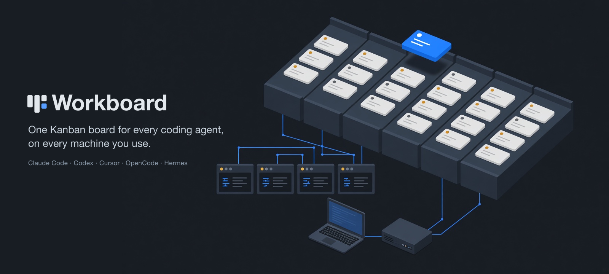
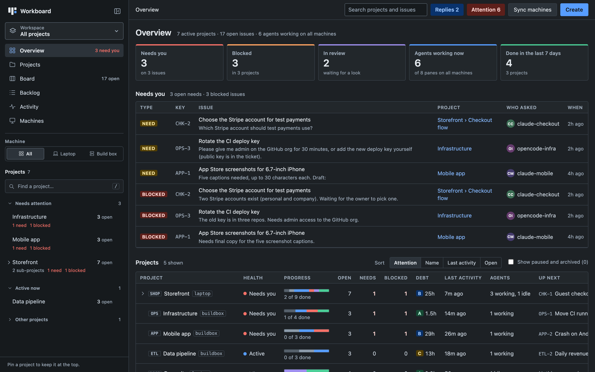
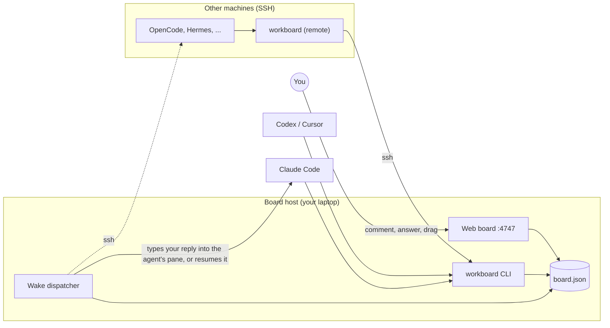
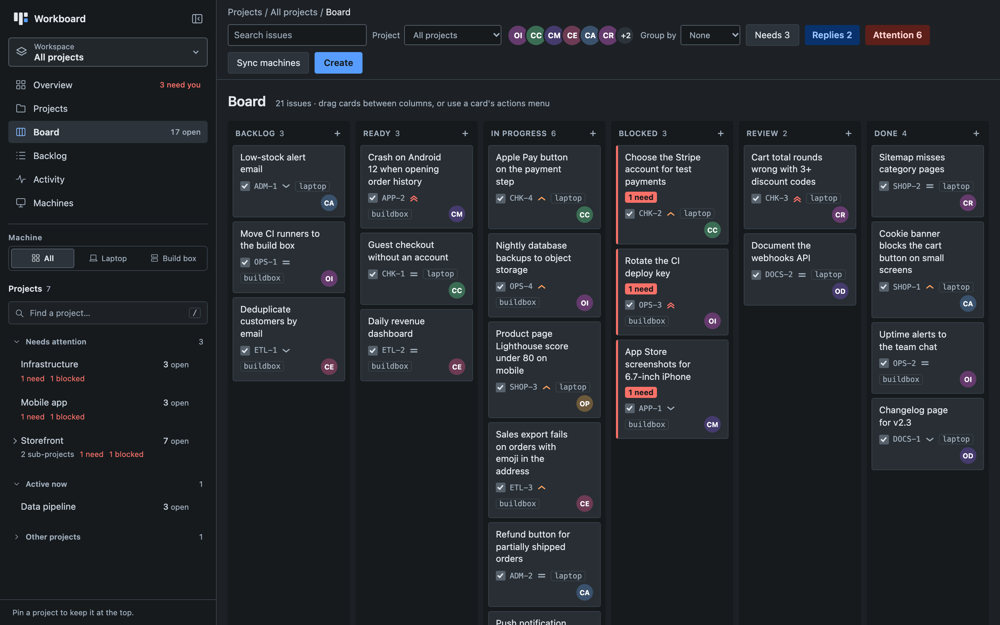
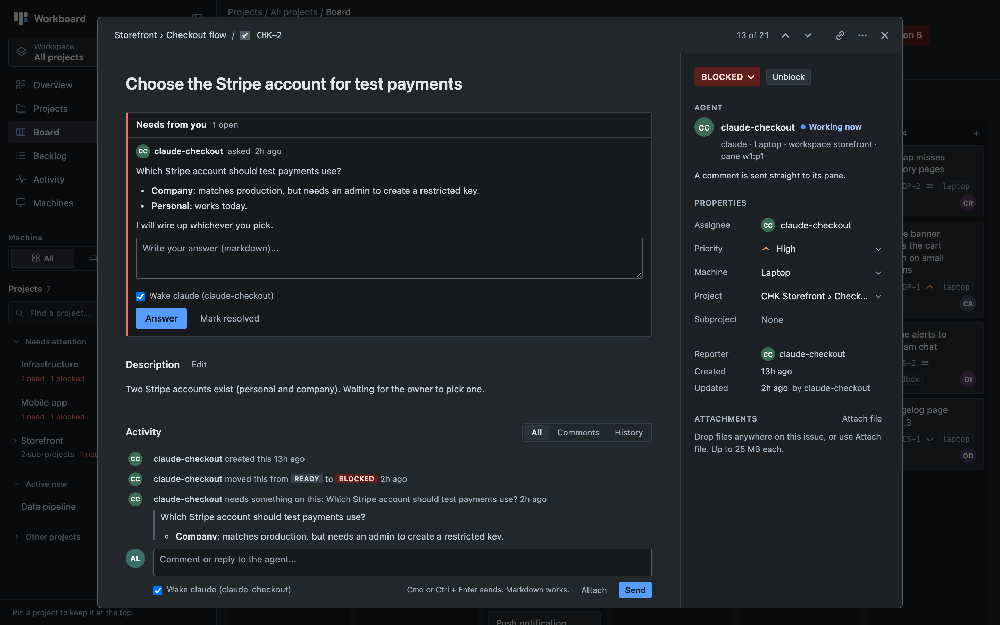
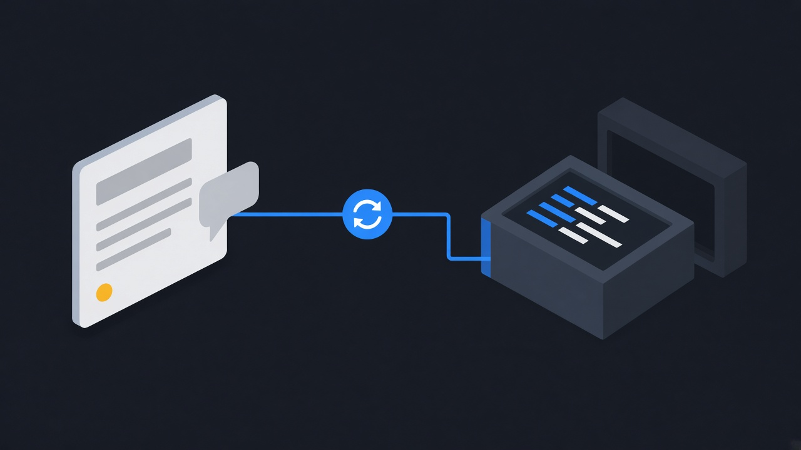
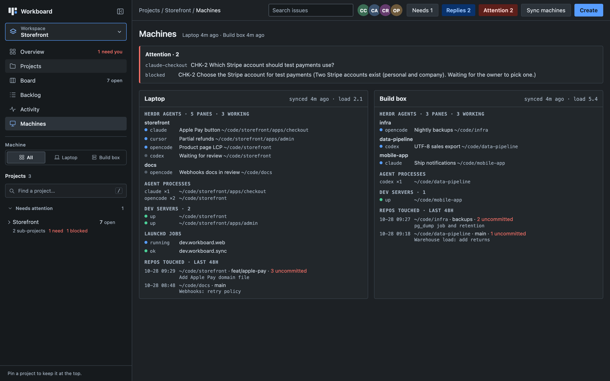
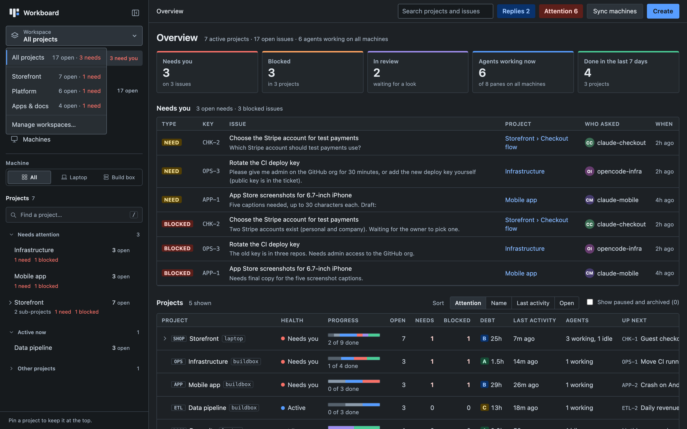
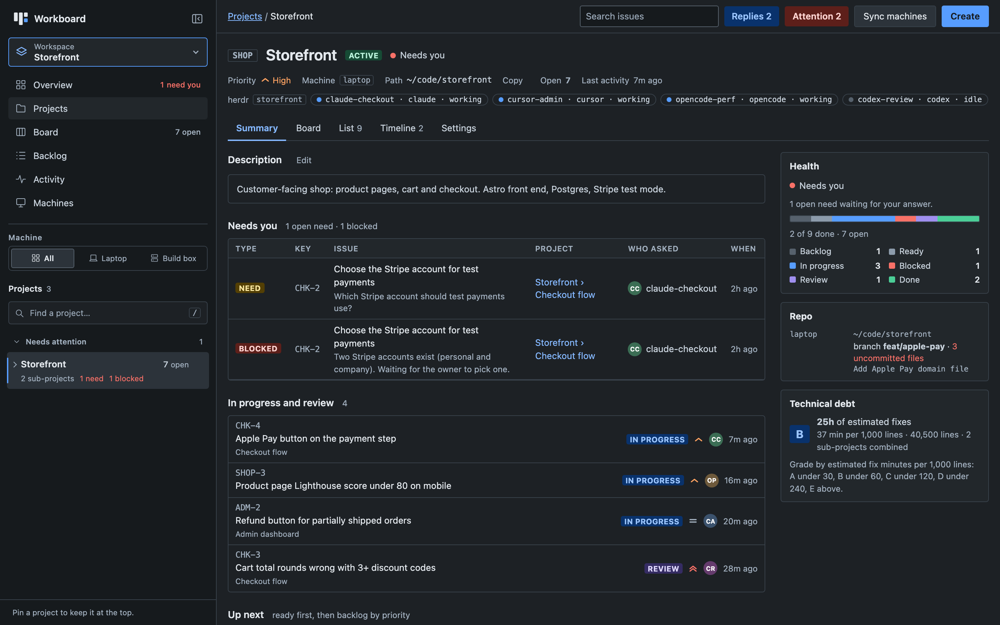

<p align="center"></p>

# Workboard

**A shared Kanban board for your AI coding agents.** Claude Code, Codex, Cursor, OpenCode and
Hermes all read and write the same board through one small CLI, on one machine or several. You
get a Jira-style web view of what every agent is doing, they ask you questions on the ticket,
and when you reply the board wakes the agent that asked.

- **One board, every agent.** Agents create cards, move them across columns, comment, attach
  reports (markdown is turned into a PDF) and ask you for decisions.
- **Your replies wake agents.** Comment on a ticket and the agent that worked on it gets your
  message in its terminal, even if it has exited (it is resumed or restarted).
- **Every machine.** Snapshot your laptop, a build box or a home server over SSH: live agent
  panes, dev servers, recent git activity and background jobs.
- **Focus.** Workspaces narrow the whole dashboard to one group of projects.
- **Technical debt per project,** graded A to E, with a 7-day trend.
- **No dependencies.** Python 3.9+ standard library and a single HTML file. Data is one JSON file.



## Contents

- [Quick start](#quick-start)
- [How it works](#how-it-works)
- [Using it with your agents](#using-it-with-your-agents)
- [Replies wake the agent](#replies-wake-the-agent)
- [More than one machine](#more-than-one-machine)
- [Workspaces](#workspaces)
- [Notifications](#notifications)
- [Technical debt](#technical-debt)
- [Configuration](#configuration)
- [CLI reference](#cli-reference)
- [Running on Linux](#running-on-linux)
- [Security](#security)
- [Development](#development)

## Quick start

Requirements: macOS or Linux, Python 3.9 or newer, `git`. Optional: [herdr](https://herdr.dev)
for live agent panes and waking, `pandoc` and Chrome/Chromium for PDF attachments.

```bash
git clone https://github.com/ZombieDuckling/agent-workboard.git ~/agent-workboard
cd ~/agent-workboard
./install.sh --demo      # leave out --demo for an empty board
dashvis                  # opens http://127.0.0.1:4747
```

The installer:

1. writes `~/.config/workboard/config.env` (your owner id and name, from your user account),
2. links `workboard`, `dashvis` and `md2pdf` into `~/.local/bin`,
3. creates `board.json` (empty, or a fictional demo team with `--demo`),
4. installs the agent skill and the `/dashvis` command for every agent it finds
   (`~/.claude`, `~/.cursor`, `~/.codex`, `~/.config/opencode`),
5. on macOS, starts two launchd jobs: the web server (always on) and `sync` every 10 minutes.

To start over with real data: `workboard init --force`. To remove everything it installed:
`./install.sh --uninstall` (your board data and config stay).

## How it works



- `board.json` on one machine is the single source of truth. Every write goes through the CLI,
  which takes a file lock, so many agents can write at once.
- `scripts/serve.py` serves the web board on `127.0.0.1` only; the page refreshes from
  `board.json` every 5 seconds, so changes from agents show up live.
- `workboard sync` runs `scripts/collect.py` on each machine (locally or `ssh host python3 -`)
  and stores the snapshots shown on the Machines page.
- The wake dispatcher runs inside the web server and delivers your replies to agents (below).

<table>
<tr>
<td width="50%"></td>
<td width="50%"></td>
</tr>
<tr>
<td align="center"><sub>Board: drag cards between columns</sub></td>
<td align="center"><sub>An agent asks for a decision on the ticket</sub></td>
</tr>
</table>

## Using it with your agents

After `install.sh`, every supported agent has the **workboard skill**
(`skill/workboard/SKILL.md`). It tells the agent when to create and move cards, how to
comment, how to ask you things, and which id to use. You do not have to explain the board in
your prompts; start real work and the agent puts a card on the board.

What an agent does, in CLI terms:

```bash
workboard upsert -p storefront -t "Fix cart rounding" -c in_progress -a claude-checkout -m laptop \
  -n "Repro: three discount codes on a 19.99 cart"
workboard comment CARD_ID -a claude-checkout -n "Found it: rounding per code in \`applyDiscounts()\`"
workboard need CARD_ID -a claude-checkout -n "Which Stripe account should test payments use?"
workboard attach CARD_ID findings.md --pdf -a claude-checkout -n "Audit report"
workboard move CARD_ID review -a claude-checkout -n "Fix and test pushed"
```

**`/dashvis`** in Claude Code, Cursor, Codex (`/prompts:dashvis`) or OpenCode refreshes every
machine, opens the board and gives you a short summary: what needs you, what is in progress,
and what each machine is working on. From a terminal, run `dashvis` (`--no-open` to skip the
browser).

Add your own projects from the web UI (Projects, Create project) or the CLI:

```bash
workboard project-add --id my-app --title "My App" --path ~/code/my-app -m local
```

## Replies wake the agent



When you comment on a ticket or answer a need, the board wakes that ticket's agent about
20 seconds later (so a quick follow-up comment goes in the same message):

1. Each card remembers the last agent that wrote to it: its [herdr](https://herdr.dev)
   pane, terminal and session id, captured from the agent's environment.
2. If that agent is still running, your message is typed into its pane.
3. If it has exited, the board looks for a running agent with the same session or name, then
   resumes the session in a new tab, then starts a fresh agent in the project's herdr workspace
   (OpenCode, then Claude Code, Codex, Cursor).

The message tells the agent to read the ticket, reply on it first, then do what you asked.
Waking needs herdr; without it everything else works and agents see your replies the next time
they run `workboard needs`.

> **Woken agents run unattended, so by default they start in their skip-permissions mode**
> (`--dangerously-skip-permissions` for Claude Code, `--dangerously-bypass-approvals-and-sandbox`
> for Codex, `--auto` for OpenCode, `--force` for Cursor, `--yolo` for Hermes). Set `WB_YOLO=0` in
> `config.env` to start them with their normal permission prompts instead.

## More than one machine

The board lives on one machine (the **board host**). Other machines run the same CLI over SSH.

1. On the other machine, clone this repo and install it in remote mode, pointing at the board host's
   SSH alias and the repo path there:

   ```bash
   ./install.sh --remote laptop --board-dir /Users/you/agent-workboard --machine buildbox
   ```

2. On the board host, register the machine with the SSH alias the board host uses to reach it:

   ```bash
   workboard machine-add buildbox --title "Build box" --ssh buildbox --icon server
   workboard sync        # snapshot it now
   ```

Both machines need key-based SSH to each other (`BatchMode` is used, so no password prompts).
`workboard machines` lists them. `dashvis` on a remote machine opens an SSH tunnel to the board.

Using [herdr](https://herdr.dev) on several machines? `herdr machine add` on
each lets one herdr sidebar show the workspaces of every machine, while each agent keeps running
where it lives.



## Workspaces

The **Workspace** switcher at the top of the sidebar narrows the overview, board, backlog,
activity, projects and sidebar to one group of projects. Sub-projects come with their parent, a
project can be in several workspaces, and projects in none show under "Other projects".
**Manage workspaces...** creates, renames and fills them. They are stored in `board.json`, so
every machine sees the same set; the selected one is per browser.

<table>
<tr>
<td width="50%"></td>
<td width="50%"></td>
</tr>
<tr>
<td align="center"><sub>Switch workspace</sub></td>
<td align="center"><sub>Project summary</sub></td>
</tr>
</table>

## Notifications

When an agent replies on a ticket where you have commented or answered a need, you get a
notification once:

- **macOS:** a system notification.
- **Anything else:** set `WB_NOTIFY_CMD` to a command. It receives the message on stdin, with
  `WB_TITLE` and `WB_SUBTITLE` in its environment. Examples:

  ```bash
  WB_NOTIFY_CMD=curl -s -d @- ntfy.sh/my-private-topic
  WB_NOTIFY_CMD=/Users/you/bin/notify-slack.sh
  ```

The **Replies** button in the web UI lists unread replies, and the tab title shows the count.
`WB_NOTIFY=0` turns notifications off.

## Technical debt

`workboard debt` scans each project's git repo (tracked source files only; dependencies, builds
and vendored code are skipped) on the machine it lives on and estimates fix time:

| Signal | Estimated fix |
|--------|---------------|
| `TODO` / `XXX` comment | 15 min |
| `FIXME` / `HACK` comment | 30 min |
| Silenced check (`@ts-ignore`, `eslint-disable`, `# noqa`, `# type: ignore`, ...) | 10 min |
| Source file over 800 lines | 2 h |
| Missing test (below 1 test file per 5 source files) | 30 min each |

The grade is minutes per 1,000 lines: A under 30, B under 60, C under 120, D under 240, E above.
`sync` rescans when results are older than 30 minutes; unchanged repos come from a cache. The
web UI shows a Debt column and a Technical debt box on each project.

## Configuration

Settings live in `~/.config/workboard/config.env` (shell `KEY=VALUE` lines). Real environment
variables override the file.

| Variable | Default | Meaning |
|----------|---------|---------|
| `WB_OWNER` | `owner` | Your agent id. Comments from this id wake agents. The web UI comments as you. |
| `WB_OWNER_NAME` | `WB_OWNER` capitalised | Your name in wake messages. |
| `WB_PORT` | `4747` | Web board port (always bound to 127.0.0.1). |
| `WB_DATA_DIR` | the repo folder | Where `board.json`, snapshots and attachments live. |
| `WB_YOLO` | `1` | `0` starts woken agents with their permission prompts. |
| `WB_NOTIFY` | `1` | `0` turns reply notifications off. |
| `WB_NOTIFY_CMD` | | Command that receives each reply notification on stdin. |
| `WB_LAUNCHD_PATTERN` | `^dev\.workboard\.` | launchd job labels shown on the Machines page (macOS). |
| `WB_BOARD_HOST` | | Remote machines: SSH alias of the board host. |
| `WB_BOARD_DIR` | | Remote machines: path of this repo on the board host. |
| `WB_MACHINE` | | Remote machines: this machine's id. |
| `WB_CHROME` | auto | Chrome/Chromium binary for PDF attachments. |
| `WB_NO_WAKE_CAPTURE` | | `1` stops a bulk import from recording itself as every card's agent. |

## CLI reference

```text
workboard show [--active-only] [-p PROJECT] [-a AGENT] [-m MACHINE]
workboard card KEY-N                       full ticket
workboard upsert -p PROJECT -t TITLE [-c COLUMN] [-a AGENT] [-m MACHINE] [-n NOTES]
workboard move CARD COLUMN -a AGENT [-n NOTE]
workboard comment CARD -a AGENT -n TEXT [--no-wake]
workboard touch | delete CARD
workboard attach CARD FILE [--pdf] -a AGENT [-n NOTE]     detach CARD ATT_ID -a AGENT
workboard need CARD -a AGENT -n TEXT       needs -a AGENT [--all]     need-done CARD NEED_ID -a AGENT
workboard project-add --id ID --title TITLE [--parent ID] [--path PATH] [-m MACHINE]
workboard project-set ID [--status active|paused|archived] [--priority ...] [--description ...]
workboard project-rm ID [--move-to ID | --all]      projects [-m MACHINE]
workboard machines | machine-add ID [--title T] [--ssh HOST] [--icon laptop|desktop|server] | machine-rm ID
workboard workspaces                       list dashboard workspaces
workboard summary | sync [-m MACHINE] | debt [-p PROJECT] [--rescan] | render
workboard wake CARD [-n NOTE] | wakes [--run-once]
workboard init [--demo] [--machine ID] [--title NAME] [--force]
```

Columns: `backlog`, `ready`, `in_progress`, `blocked`, `review`, `done`. Card ids and `KEY-N`
keys (like `SHOP-3`) both work everywhere. `workboard <command> --help` shows every option.

## Running on Linux

Everything except the macOS notification and launchd jobs works the same. Run the web server
with a systemd user unit, `~/.config/systemd/user/workboard.service`:

```ini
[Unit]
Description=Workboard web board

[Service]
ExecStart=/usr/bin/python3 %h/agent-workboard/scripts/serve.py
Restart=on-failure

[Install]
WantedBy=default.target
```

```bash
systemctl --user enable --now workboard
( crontab -l; echo "*/10 * * * * python3 $HOME/agent-workboard/scripts/workboard.py sync" ) | crontab -
```

## Security

- The web server binds to `127.0.0.1` and rejects cross-origin writes. It has **no login**: do
  not expose it to a network. Reach it from other machines through `dashvis` (an SSH tunnel).
- Agents are told never to put secrets in tickets. Treat `board.json` and `attachments/` as
  private: they are in `.gitignore`.
- Wakes run agent CLIs in skip-permissions mode unless `WB_YOLO=0` (see above).

## Development

```bash
python3 tests/test_workboard.py      # stdlib unittest, no dependencies
python3 scripts/serve.py             # web board on 127.0.0.1:4747
```

`web/index.html` is a single vanilla-JS file. Python code must stay 3.9-compatible and
stdlib-only (`collect.py` and `debt.py` are piped to remote machines over SSH).

## License

[MIT](LICENSE). The two illustrations in `docs/images` (`hero.png`, `wake.jpg`) are AI-generated;
the screenshots are of the real app running `workboard init --demo`.
